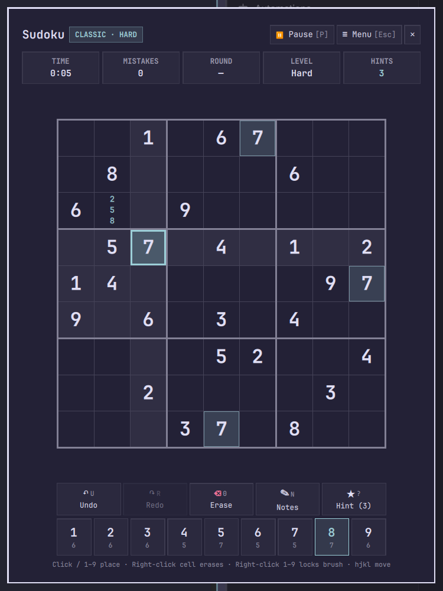

# Sudoku Challenge (`gruut.sudoku`)

A theme-aware Sudoku overlay and bar widget for [Omarchy](https://omarchy.org/) featuring both **Classic Sudoku** (Easy, Medium, Hard) and a progressive **Survival Challenge** mode with full keyboard and mouse controls.



## Features

- **Two Game Modes:**
  - **Classic:** Choose Easy, Medium, or Hard with guaranteed unique solutions and best-time tracking per difficulty.
  - **Survival Challenge:** Start on Easy with 3 lives (`♥`). Each wrong placement costs 1 life; clearing a board grants `+2` bonus lives and advances to the next tier (`Easy → Medium → Hard → Expert → Extreme ∞`).
- **Full Mouse & Keyboard Controls:**
  - Click cells to select, click `1–9` numpad buttons to place digits or toggle pencil notes.
  - **Right-click a cell** to immediately erase its value/notes.
  - **Right-click a numpad digit (`1–9`)** to lock/unlock **Brush Mode** for rapid single-click placement across the board.
  - Interactive toolbar for **Undo**, **Redo**, **Erase**, **Notes (ON/OFF)**, **Hint**, **Pause**, and **Menu**.
  - Automatic peer note cleanup when a valid digit is placed, plus remaining-count badges (`✓` when completed) on each numpad key.
- **Persistent Auto-Save & Statistics:**
  - Automatically saves active games to `~/.local/share/omarchy-sudoku/save.json` and records career stats in `stats.json`.
- **100% Theme-Adaptive:**
  - Uses Omarchy `qs.Commons` (`Color`, `Style`, `Border`) tokens so colors, borders, rounding, and fonts automatically match your active Omarchy theme.

## Install

```bash
omarchy plugin add https://github.com/Morganczech/omarchy-sudoku-plugin --enable
```

## Update & Remove

```bash
# Update plugin
omarchy plugin update gruut.sudoku

# Move widget to another bar section
omarchy bar move gruut.sudoku --section right

# Remove plugin
omarchy plugin remove gruut.sudoku
```

## Requirements & Dependencies

- **Omarchy 4.x** (`quickshell` runtime and `omarchy` CLI)
- **External dependencies:** None (the puzzle generator, solver, and persistence layer run purely inside Quickshell QML/JS).
- Optional for running unit tests locally: `node` (Node.js 20+).

## Usage

Open **Sudoku Challenge** from the bar button labeled `9` or toggle the overlay from a terminal / keybinding:

```bash
omarchy-shell shell toggle gruut.sudoku
```

### Controls

| Input | Action |
| --- | --- |
| **Arrow keys** / **hjkl** / **Left-click cell** | Select cell |
| **1–9** / **Click numpad 1–9** | Enter digit (or toggle candidate in Notes mode) |
| **Right-click cell** / **0** / **Backspace** / **Delete** / **X** | Erase cell |
| **Right-click numpad 1–9** | Lock / unlock Brush mode for that digit |
| **N** / **Click Notes** | Toggle pencil notes mode |
| **U** / **Click Undo** | Undo move |
| **Ctrl+R** / **R** / **Click Redo** | Redo move |
| **?** / **Click Hint** | Reveal correct digit for selected cell |
| **P** / **Click Pause** | Pause / resume game |
| **Esc** / **Click Menu** | Return to main menu (or clear brush lock) |
| **Q** / **Click ✕** | Save and close overlay |

## Development & Tests

Run the generator, solver, challenge ladder, and state unit tests with Node.js:

```bash
node --test test/engine.test.js
omarchy plugin validate .
```

## License

[MIT](LICENSE) © 2026 Morganczech
